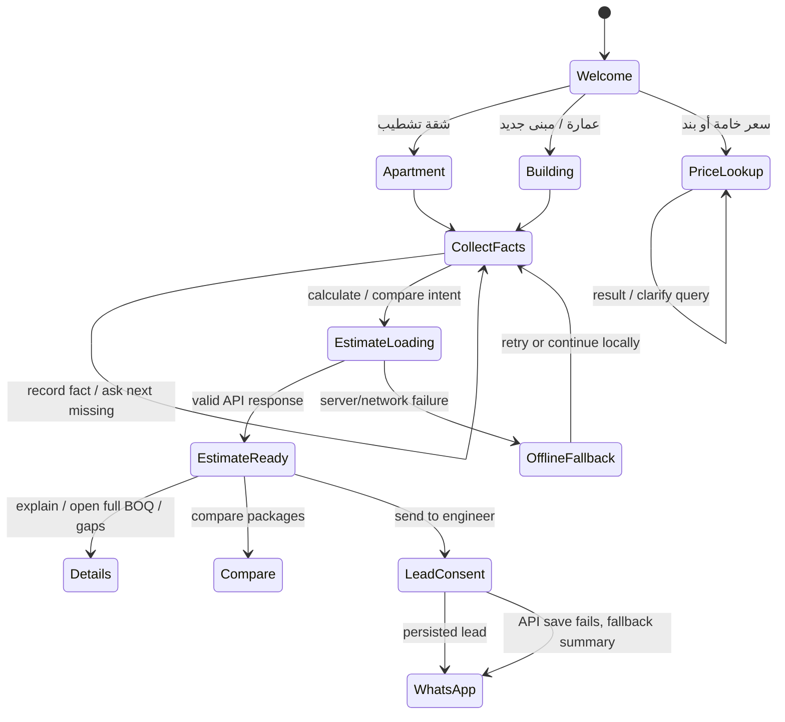

# Widget State Machine

Implementation state includes selected service, structured project facts, pending fact, question count, last sanitized estimate, estimate ID and price-book version. It saves structured facts only (no name/phone). The estimate is not cached as a contract-ready document; the stored snapshot should be recalculated after price book changes.

Note: scenario preview is separate and should not overwrite the current project until the visitor accepts the change. The architecture supports that rule, but end-to-end persistence of all branches remains part of alpha validation.
